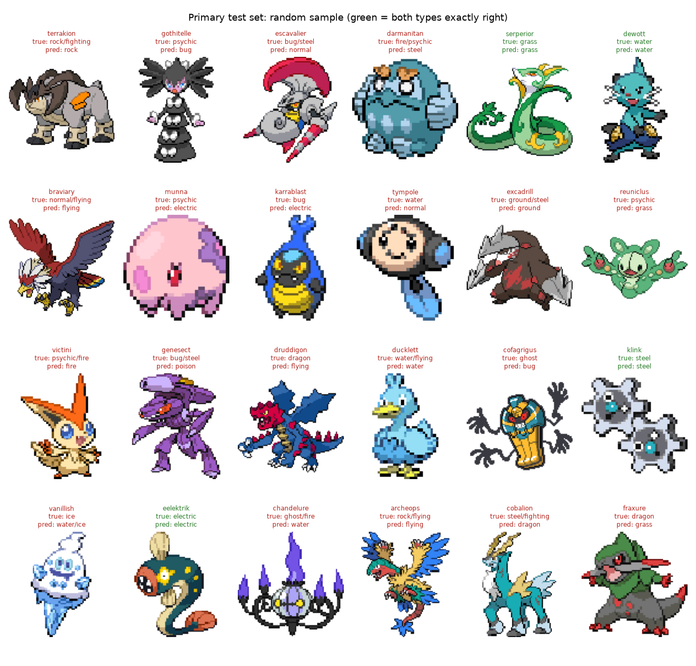

# Evaluation: dev_resnet18

resnet18, best epoch 4, trained with Black/White-style sprites; calibrated (T = 1.15), second-type threshold 0.43.

## Headline: primary test set

Gen 5 Black/White front sprites, 161 images, species never seen in training.

| metric | value | 95% CI |
|---|---|---|
| exact match (both types right) | 0.211 | 0.149-0.273 |
| top type is a true type | 0.435 | |
| mAP | 0.345 | 0.320-0.428 |
| macro F1 | 0.301 | |
| predicted dual-typed / actually dual-typed | 0.07 / 0.49 | |

### Against the baselines (same training variant)

| model | exact match | top type correct | mAP |
|---|---|---|---|
| prior | 0.050 | 0.118 | 0.083 |
| color histogram | 0.211 | 0.366 | 0.273 |
| **dev_resnet18** | **0.211** | **0.435** | **0.345** |

## Out-of-distribution checks

| set | images | exact match | top type correct | mAP |
|---|---|---|---|---|
| primary | 161 | 0.211 | 0.435 | 0.345 |
| test_other_media | 1269 | 0.136 | 0.369 | 0.287 |
| test_shiny | 161 | 0.149 | 0.261 | 0.248 |
| test_grayscale | 161 | 0.075 | 0.211 | 0.203 |
| val_gameboy_color | 40 | 0.150 | 0.275 | 0.469 |
| val_gameboy_gray | 40 | 0.075 | 0.200 | 0.314 |

Gen 5 in other media, by medium: 3d_render 0.140 (n=931), illustration 0.159 (n=176), vector 0.093 (n=162)

The Game Boy rows come from val families (Gen 1 only has monochrome sprites); compare gray against color for the same Pokemon rather than against the test numbers.

## Per-type results (primary test)

| type | precision | recall | F1 | support |
|---|---|---|---|---|
| normal | 0.39 | 0.58 | 0.47 | 19 |
| fighting | 0.40 | 0.12 | 0.19 | 16 |
| flying | 0.61 | 0.58 | 0.59 | 19 |
| poison | 0.50 | 0.57 | 0.53 | 7 |
| ground | 0.33 | 0.09 | 0.14 | 11 |
| rock | 1.00 | 0.10 | 0.18 | 10 |
| bug | 0.00 | 0.00 | 0.00 | 18 |
| ghost | 0.00 | 0.00 | 0.00 | 11 |
| steel | 0.67 | 0.33 | 0.44 | 12 |
| fire | 0.77 | 0.62 | 0.69 | 16 |
| water | 0.43 | 0.53 | 0.48 | 19 |
| grass | 0.70 | 0.80 | 0.74 | 20 |
| electric | 0.33 | 0.18 | 0.24 | 11 |
| psychic | 0.00 | 0.00 | 0.00 | 16 |
| ice | 1.00 | 0.14 | 0.25 | 7 |
| dragon | 0.50 | 0.10 | 0.17 | 10 |
| dark | 0.40 | 0.25 | 0.31 | 16 |
| fairy | 0.00 | 0.00 | 0.00 | 2 |

## Inference time

Single image, end to end (preprocessing + forward pass; file already in memory), cpu, 12 threads, 50 images after warm-up: median **8.8 ms**, mean 8.8 ms, max 10.6 ms.

