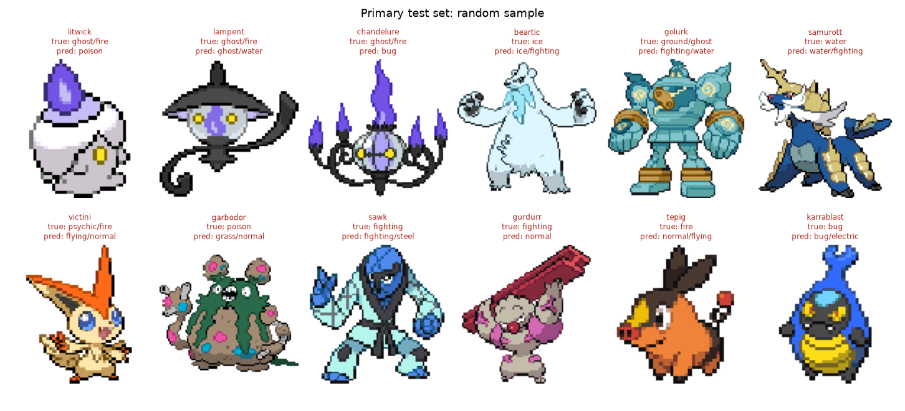

# Round 3 evaluation (test set)

Ensemble of the convnext_tiny cross-validation fold models (`runs/r3/convnext_tiny/9faa97827c`): pool `avg`, head `set`, auxiliary heads on. Calibrated on out-of-fold predictions: T = 1.42, second-type threshold 0.18 (tuned for per-image F1).

## Primary test: Gen 5 Black/White sprites

161 images, species never seen in training in any form.

| metric | value | 95% CI |
|---|---|---|
| exact match (both types right) | 0.161 | 0.106-0.224 |
| per-image F1 | 0.445 | 0.391-0.501 |
| top type is a true type | 0.522 | 0.447-0.602 |
| mAP | 0.424 | 0.395-0.508 |
| predicted dual / actual dual | 0.69 / 0.49 | |

### Against the baselines

| model | exact | F1 | top type | mAP |
|---|---|---|---|---|
| prior | 0.050 | - | 0.118 | 0.083 |
| color histogram | 0.205 | - | 0.360 | 0.273 |
| **round-3 ensemble** | **0.161** | **0.445** | **0.522** | **0.424** |

## Ablation: training with Black/White-style sprites

| metric | without BW (main) | with BW | difference (main - BW), 95% CI |
|---|---|---|---|
| exact | 0.161 | 0.186 | -0.025 (-0.075 to +0.019) |
| F1 | 0.445 | 0.441 | +0.004 (-0.031 to +0.039) |
| top type | 0.522 | 0.491 | +0.031 (-0.025 to +0.087) |
| mAP | 0.424 | 0.409 | +0.015 (-0.010 to +0.037) |

A CI that excludes 0 means the difference is unlikely to be chance (images resampled together).

## Out-of-distribution checks

| set | model | images | exact | F1 | top type | mAP |
|---|---|---|---|---|---|---|
| primary | main | 161 | 0.161 | 0.445 | 0.522 | 0.424 |
| primary | bw | 161 | 0.186 | 0.441 | 0.491 | 0.409 |
| test_other_media | main | 1269 | 0.117 | 0.395 | 0.457 | 0.363 |
| test_other_media | bw | 1269 | 0.129 | 0.396 | 0.470 | 0.362 |
| test_shiny | main | 161 | 0.118 | 0.311 | 0.317 | 0.295 |
| test_shiny | bw | 161 | 0.130 | 0.328 | 0.354 | 0.293 |
| test_grayscale | main | 161 | 0.050 | 0.200 | 0.205 | 0.229 |
| test_grayscale | bw | 161 | 0.062 | 0.193 | 0.193 | 0.225 |
| oof_gameboy_color | main | 302 | 0.175 | 0.417 | 0.480 | 0.347 |
| oof_gameboy_color | bw | 302 | 0.209 | 0.413 | 0.440 | 0.335 |
| oof_gameboy_gray | main | 302 | 0.056 | 0.178 | 0.139 | 0.205 |
| oof_gameboy_gray | bw | 302 | 0.046 | 0.150 | 0.129 | 0.195 |

Gen 5 in other media (main), by medium: 3d_render F1 0.393 (n=931), illustration F1 0.391 (n=176), vector F1 0.410 (n=162)

Game Boy rows are Gen 1 Pokemon scored out-of-fold (by the fold model that never trained on their family); compare gray against color for the same Pokemon, not against the test rows.

## Per-type results (primary test, main)

| type | precision | recall | F1 | support |
|---|---|---|---|---|
| normal | 0.39 | 1.00 | 0.56 | 19 |
| fighting | 0.22 | 0.25 | 0.24 | 16 |
| flying | 0.50 | 0.74 | 0.60 | 19 |
| poison | 0.29 | 0.57 | 0.38 | 7 |
| ground | 0.33 | 0.27 | 0.30 | 11 |
| rock | 0.25 | 0.50 | 0.33 | 10 |
| bug | 0.38 | 0.17 | 0.23 | 18 |
| ghost | 0.60 | 0.27 | 0.38 | 11 |
| steel | 0.56 | 0.42 | 0.48 | 12 |
| fire | 0.54 | 0.44 | 0.48 | 16 |
| water | 0.45 | 0.68 | 0.54 | 19 |
| grass | 0.62 | 0.90 | 0.73 | 20 |
| electric | 0.75 | 0.27 | 0.40 | 11 |
| psychic | 0.25 | 0.19 | 0.21 | 16 |
| ice | 0.67 | 0.57 | 0.62 | 7 |
| dragon | 0.38 | 0.30 | 0.33 | 10 |
| dark | 0.25 | 0.12 | 0.17 | 16 |
| fairy | 0.00 | 0.00 | 0.00 | 2 |

## Calibration and inference time

Test-set expected calibration error (primary + other media, all 18 outputs): 0.013 (plot: eval_round3_reliability.png).

Single image on CPU, end to end (preprocessing + all 5 ensemble members), 12 threads, 50 images after warm-up: median **193 ms**, max 246 ms.

